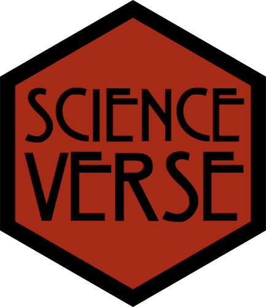
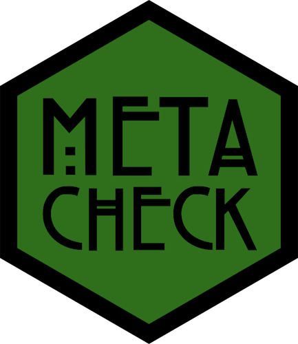

```{r, include=FALSE}
folder <- normalizePath(".") |> basename()
url <- sprintf("https://scienceverse.org/talks/%s/", folder)
link_display <- sprintf("{height=300} {height=320 style='margin: 0 1em;'} {height=300}\\n\\n[%s](%s)", url, url)
# make QR code
qrcode::qr_code(url) |> 
  qrcode::generate_svg("images/qrcode.svg", 
                       background = "#E9E8E5", # bg-color from scss
                       foreground = "black")
```
---
title: "Template Talk"
subtitle: "Authors or subtitle"
author: "`r link_display`"
format: 
  revealjs:
    logo: images/metacheck.png
    theme: style.scss
    transition: none
    transition-speed: fast
    syntax-highlighting: zenburn
---

```{r, include = FALSE}
library(tidyverse)
library(flextable)

knitr::opts_chunk$set(echo = FALSE)

set_flextable_defaults(font.size = 20)
theme_set(theme_minimal(base_size = 17))
set.seed(8675309)
```

# Abstract


# Thank You! {.center}

:::: {.columns}
::: {.column width="50%"}
Speaker: [PERSON](url)


:::
::: {.column width="50%"}
Contact us at <https://www.scienceverse.org/metacheck/>
:::
::::

<`r url`>